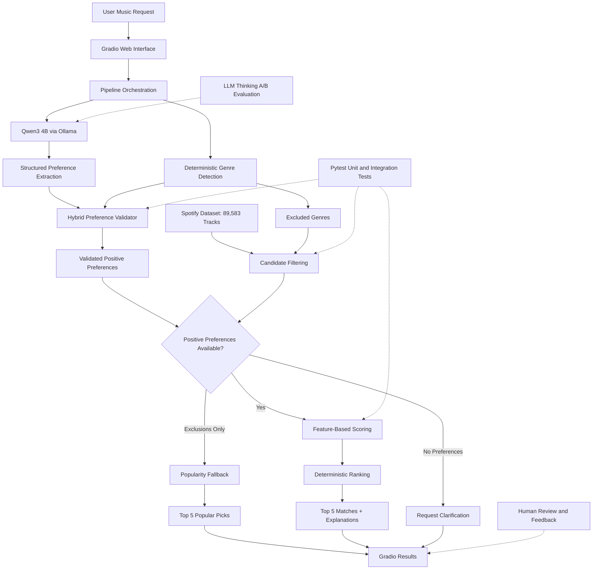

# VibeMatch AI — System Architecture

The following diagram illustrates the end-to-end recommendation pipeline, from natural-language input to explainable music recommendations.

## Component Responsibilities

| Component | Purpose |
|---|---|
| Gradio Web Interface | Collects user requests and displays results |
| Qwen3 4B / Ollama | Interprets natural-language music preferences |
| Hybrid Preference Validator | Normalizes explicit preferences and corrects certain LLM errors |
| Genre Detection | Recognizes standard names, spelling variants, and exclusions |
| Candidate Filtering | Removes tracks matching excluded genres |
| Feature-Based Scoring | Calculates preference-matching scores |
| Deterministic Ranking | Sorts by match score, popularity, and track ID |
| Popularity Fallback | Handles exclusion-only requests without inventing preference scores |
| Reliability Tests | Verify individual functions and pipeline behavior |
| Human Review | Evaluates recommendation relevance and known limitations |
